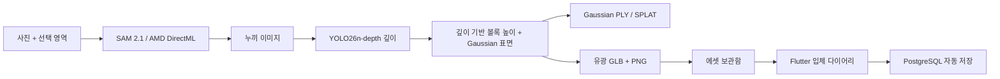
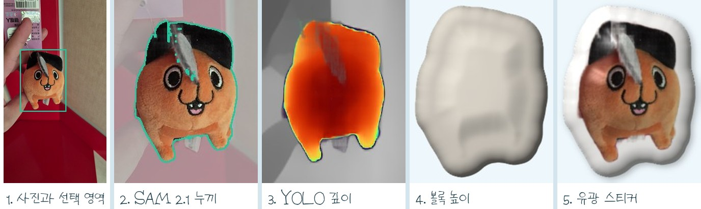

# GoodMorNing ☀️

사진 속 굿즈를 모으고, 볼록 스티커로 만들어 다이어리를 꾸미는 **Flutter Web + 로컬 GPU 서버** 앱입니다.

프론트는 **[GitHub Pages](https://niraaah.github.io/GoodMorNing/)**, GPU API와 데이터 저장소는 **사용자 Windows PC**에서 실행합니다. GitHub Actions는 main에 push할 때 Flutter 웹을 빌드해서 Pages에 배포하며, GPU 작업을 실행하는 서버는 아닙니다.

원본 [프로토타입](https://github.com/mokma18/goodmorning-prototype-demo)의 홈·다이어리·훔쳐보기 소스를 재사용합니다. **Flutter 앱의 HtmlElementView 안에 원본 HTML/CSS/JS 화면을 넣은 혼합 구조**이며, 모든 UI를 네이티브 Flutter 위젯으로 다시 그린 구현은 아닙니다. 다이어리는 원본의 투명 바인더, 표지·링 여닫기, 사진·마스킹테이프, 입체 스티커, 페이지 넘김, 편집/취소/게시 UI를 사용합니다. 에셋함과 사진의 SAM 2 선택 창은 Flutter입니다.

스티커의 테두리·볼록 메시·유광 GLB 생성 함수는 [goodmorning-3d](https://github.com/bloodmoon3929/goodmorning-3d)의 `pipeline/sticker.py`에서 재사용합니다. 홈의 기존 샘플 배치는 원본 방식대로 브라우저에 보관하고, 생성한 에셋과 앱 다이어리는 PC의 DB에 저장합니다.

## 구현된 기능

- 스티커 사진·영역 선택 → **다음 · 굿즈 연결** → 후보 검색 → **선택하고 만들기**. 사용자가 고른 실제 상품만 스티커 메타데이터에 저장하며 에셋 상세와 다이어리 상품 링크에서 열 수 있습니다. ‘연결 없이 만들기’, 사진 재선택, 상품 링크 직접 입력도 제공합니다.
- 추천은 상품명·캐릭터명으로 수집한 후보를 **EmbeddingGemma 2의 사진 임베딩**과 비교해 정렬합니다. 상품 사진을 가져올 수 없으면 상품 설명과 비교하며 카드에 그 차이를 표시합니다. 유사도는 상품 동일성이나 스티커 품질의 확률이 아닙니다. 다른 옵션·색상일 수 있어 사용자의 선택이 필요합니다.

## 굿즈 검색 연결과 현재 제한

사진은 로컬 PC의 `127.0.0.1:8788` 검색 서비스에서 비교합니다. SAM 2와 의존성이 충돌하지 않도록 `.venv-search`를 따로 사용합니다. 현재 PC의 EmbeddingGemma 2는 **CPU/float32**, SAM 2는 기존 **AMD DirectML GPU**로 실행합니다. 사진을 쇼핑몰이나 외부 AI 서비스에 보내지 않으며, 검색어만 판매처에 전송합니다.

```powershell
.\scripts\setup-search.ps1  # 별도 Python 환경, Chromium, 고정 모델 준비
.\scripts\start.ps1         # GPU API와 검색 서비스를 함께 시작
```

| 판매처 | 연동 방식·현재 상태 |
| --- | --- |
| 네이버 | 쇼핑 검색 API는 **2026-07-31 종료**, 별도 대체 API 없음. 쇼핑 사이트도 자동 수집을 차단하므로 우회하지 않습니다. **네이버 상품 링크 직접 연결**을 지원합니다. [공식 종료 공지](https://developers.naver.com/notice/article/32530) |
| 쿠팡 | 파트너스 API HMAC 상품 검색 어댑터 구현. **현재 키 미설정으로 실제 API 연결 전**입니다. 쿠팡 웹 차단을 우회하는 크롤러는 실행하지 않습니다. |
| 포켓몬스토어·대원샵 | 초기 저장소의 선택자·수집 구조를 참고한 **Scrapy + Playwright** 검색. 요청 전 robots.txt 확인, 차단 시 중단, 사이트당 동시 1개·3초 간격. 2026-11-26 robots.txt 접근 허용 확인. 실제 상품 검색·선택자 동작은 기능 테스트하지 않았습니다. |

쿠팡 키는 **`data/search.local.json`**의 `COUPANG_ACCESS_KEY`, `COUPANG_SECRET_KEY`에만 입력합니다. 이 파일은 Git·Pages에서 제외됩니다. 설정은 다음 검색부터 읽으므로 재시작할 필요가 없습니다. 쿠팡만 쓰려면 `official_shops`를 `false`로 설정하세요. 새 키를 넣기 전까지는 화면에 ‘API 연결 대기’를 표시하며 가짜 상품으로 대체하지 않습니다. 쿠팡 API의 현재 권한·응답 호환성은 유효한 키로 별도 확인이 필요합니다.

추천이 없을 때 표시하는 안내(3문장):

> 찾는 굿즈가 없다면 아직 검색 목록에 없거나 사진에서 특징이 잘 보이지 않았을 수 있어요. 더 정확하게 찾고 스티커를 만들 수 있도록 밝은 곳에서 굿즈가 화면에 크게 나오게 선명하게 찍어 주세요. 상품명·캐릭터명을 함께 입력하거나 상품 링크를 직접 연결할 수도 있어요.

검색 오류·판매처 차단·미설정 상태는 촬영 안내와 따로 표시합니다. 검색 결과는 사용자별로 저장하고 24시간 뒤 새 검색/서버 시작 시 정리합니다. 검색 사진과 그 임베딩은 검색 중 메모리에서만 사용하며, 확정한 상품 정보는 스티커와 함께 유지합니다. 공개 상품 임베딩은 모델 버전별로 로컬 캐시하고 판매처 검색 결과는 15분간 재사용합니다. 실제 검색·추천 정확도·모바일 선택 흐름은 사용자 확인 대상입니다.

## 다이어리와 스티커 기능

상품 데이터는 PC의 PostgreSQL(Docker)에 지속적으로 저장합니다. 판매처별 상품 후보·가격 관측 기록·수집 작업·상품 이미지·모델 버전별 임베딩과 개인 에셋 연결을 분리했습니다. 수집 실패 시 과거 상품도 다시 비교하며, 화면에는 수집 날짜를 표시합니다. 기존 에셋·다이어리 데이터는 유지합니다. [현재 DB 구조](docs/database.md), 실행 스키마는 `server/schema.sql`·`server/goods/catalog.sql`을 참고하세요.

- **편집 → 개체 선택 → 모서리 드래그**로 사진·스티커 크기를 조절합니다. 위 툴바의 **회전**을 누르면 툴바가 **적용 / 취소**로 바뀌고 네 모서리가 회전 핸들로 전환됩니다. 회전 커서가 표시된 모서리를 드래그하면 개체 중심을 기준으로 자유롭게 돌아가며, **적용**하면 각도를 유지합니다. **취소**, Escape 또는 다른 개체 선택 시 회전 전 각도로 돌아갑니다. 회전 모드에서 모서리에 초점을 두고 방향키로도 조절할 수 있습니다.
- 폴라로이드 툴바의 **앞으로 / 뒤로**는 사진끼리 한 단계씩 순서를 바꿉니다. 끝에 도달한 방향은 비활성화되며, 완전히 가려진 사진은 사진 선택 목록에서 고를 수 있습니다. 사진의 순서는 게시할 때 저장되고 편집 취소 시 되돌아갑니다. **스티커는 모든 폴라로이드보다 위에 유지**되며, 사진 순서 변경은 스티커 레이어에 영향을 주지 않습니다.
- 같은 툴바의 **사진/스티커 바꾸기**는 위치·크기·적용한 각도를 유지합니다. **삭제**는 해당 페이지의 배치를 제거하며, 에셋함 삭제는 기존 이름 확인 절차를 사용합니다. 변경한 페이지는 **게시**로 저장합니다.

- 폴라로이드는 다이어리의 사진 첨부로 저장하며 스티커 목록에 표시하지 않습니다. 이전 버전에서 에셋으로 저장된 사진도 스티커 목록에서는 제외하되 기존 다이어리 참조는 유지합니다.
- 다이어리 내용은 **종이·폴라로이드 → 스티커** 순서로 합성합니다. 사진과 스티커를 하나의 평면 안에서 겹쳐 3D 깊이 교차로 사진이 스티커를 가리지 않게 했습니다. 바인더 표지·링은 원본 입체 구조를 유지합니다.
- 편집 중 폴라로이드 **아래 흰 여백을 눌러 사진별 메모**를 쓸 수 있습니다(70자). 하단 ‘폴라로이드 아래 메모’ 입력란과도 연동되며 게시/취소를 따릅니다. 사진이 없는 빈 종이에는 메모 입력을 제공하지 않습니다. 메모에는 네이버 **나눔손글씨 꽃내음** 원본 글꼴을 앱과 함께 제공합니다.

- 에셋 상세 → **삭제** → 에셋 이름을 정확히 직접 입력 → **확인하고 삭제**. 서버도 이름과 소유권을 다시 확인합니다. 삭제한 에셋은 목록에서 숨기고 **내 에셋 → 휴지통 → 복구**로 되돌릴 수 있습니다. 파일을 영구 삭제하거나 자동 정리하지 않으므로 기존 다이어리에 붙인 스티커는 유지됩니다. 공용 기본 샘플은 삭제하지 않습니다.
- 내 다이어리 첫 진입에서 **반짝임 켜기 / 나중에**를 안내합니다. 선택은 이 브라우저에 기억하며, 나중에 상단 **자이로 켜기**로 다시 켜거나 **반짝임 끄기**로 중지할 수 있습니다. 브라우저가 요구하는 센서 권한은 켜기 버튼을 누를 때 요청합니다. 저장한 선택은 실제 권한 허용을 대신하지 않습니다. 거부해도 편집은 가능하며, 사이트 설정을 변경한 뒤 **권한 확인**으로 다시 시도할 수 있습니다. 센서 값은 서버 전송·저장 없이 화면 효과에만 사용합니다. 카메라·GPS 권한은 시작할 때 요청하지 않습니다.
- 휴대폰 자이로 사용 시 **다이어리는 고정하고 스티커 조명·반사만 움직입니다.** 센서 값을 받을 수 없는 브라우저에서만 **수동 기울이기**를 제공합니다. 수동 모드에서만 드래그/방향키로 판을 기울이며, 편집 중에는 끕니다. 센서 값이 들어오면 수동 모드는 해제됩니다.
- iOS 등 센서 권한이 필요한 브라우저에서는 **자이로 켜기**를 눌러 허용해야 합니다. 권한 거부는 센서 없음으로 처리하지 않으며 수동 모드도 활성화하지 않습니다. HTTPS와 센서 사용 가능한 브라우저가 필요합니다. 센서 API가 없거나 권한 확인 후 6초 동안 유효한 값이 없으면 수동 모드를 제공합니다. 브라우저에서 하드웨어의 물리적 유무까지 확정하는 기능은 아닙니다. 카메라·얼굴 거리 확대는 사용하지 않습니다. [센서 권한 안내](https://developer.mozilla.org/en-US/docs/Web/API/Device_orientation_events)

- 원본 **훔쳐보기** 탭: 포치타·디무 다이어리 카드, 원본 샘플 다이어리 열람과 목록 복귀. [직접 열기](https://niraaah.github.io/GoodMorNing/?browse). GPU 연결 없이 열람 가능하며, 실제 이용자의 비공개 다이어리를 공개하는 기능은 아닙니다.
- 사진 업로드 후 사각형으로 굿즈 영역 선택
- 모바일에서 사진 위 터치는 영역 선택이 우선이며 사진 밖에서 스크롤합니다. 유효한 영역을 선택하고 저장하면 창이 닫히고 에셋 화면에서 업로드·생성 상태를 표시합니다. 취소는 업로드를 시작하지 않고 창을 닫습니다.
- **SAM 2.1**로 누끼 분리: Windows의 ONNX Runtime DirectML로 로컬 AMD GPU 사용
- 누끼 영역의 깊이를 **YOLO26n-depth**(ONNX, DirectML/CPU)로 추정하고, 가까운 부분일수록 높게 볼록한 표면을 만듭니다. 가우시안 입자와 함께 `.ply`, `.splat`, `.glb`, PNG로 저장합니다.
- 만드는 단계마다 과정 사진을 남깁니다(`/files/{id}/process.jpg`). 아래 [스티커 처리 흐름](#스티커-처리-흐름) 참고
- 생성 작업의 대기·진행률·실패 표시, 완료된 스티커를 에셋 보관함에 추가
- 다이어리에 스티커와 폴라로이드 추가, 끌어서 이동, 크기·회전·순서 조절, 선택 항목 제거
- 다이어리 탭은 원본 바인더 편집기를 사용합니다. 사진 메모·테이프·사진 추가/교체, 스티커 이동·크기·회전, 새 장 추가, 표지와 링 조작을 원본 UI에서 제공합니다. 이전 별도 편집기의 제목/메모/종이 색/PNG 내보내기 도구는 현재 화면에 노출하지 않습니다.
- **편집 → 게시**로 사진·테이프·에셋 배치를 PC의 `notebook_pages`에 저장합니다. 사진과 가져온 GLB는 별도 첨부 파일로 저장하며, GPU에서 만든 에셋은 기존 파일을 참조합니다. 저장 실패 시 편집 내용을 유지합니다. 원본의 페이지당 에셋 6개 제한을 유지하며 새 장에 추가할 수 있습니다.
- PostgreSQL에 에셋·생성 작업·다이어리 저장. 새로고침 후 다시 불러오기
- GitHub Pages 정적 프론트 + 접근 키로 보호된 로컬 GPU API. 같은 PC에서 앱/API를 함께 제공하는 방식도 유지

## GitHub Pages + 로컬 GPU 연결

1. [앱 주소](https://niraaah.github.io/GoodMorNing/)를 엽니다. 홈은 PC가 꺼져 있어도 열립니다.
2. PC에서 `scripts/start.ps1`, `scripts/tunnel.ps1`을 실행합니다.
3. **기본 앱 주소만 열면 이 PC의 GPU 서버에 자동 연결됩니다.** 별도 링크, 서버 주소 입력, 접근 키 입력은 필요하지 않습니다.
4. 사진 업로드·생성·에셋·다이어리는 연결된 PC에서 처리합니다. PC, API, 터널이 모두 켜져 있어야 합니다.

공개 서버 주소는 GitHub Actions 변수 `GPU_API_URL` → `runtime-config.json`으로 전달합니다. 앱이 `/auth/guest`에서 브라우저별 연결 토큰을 자동 발급받아 localStorage에 보관합니다. 사진·작업·다이어리는 토큰별로 분리하고 기본 샘플만 공유합니다. 다른 브라우저나 기기에서는 별도 보관함이 열리며, 브라우저 저장소를 지우면 기존 자동 연결 보관함을 다시 열 수 없습니다.

기존 소유자의 데이터와 접근 키는 그대로 유지하며, 기존 비공개 연결 링크 또는 수동 설정으로 접근할 수 있습니다. 소유자 키는 공개 코드·Actions 변수·배포 파일에 넣지 않습니다. 이 구성은 로그인 없는 공개 방문자가 자신의 보관함에서 로컬 GPU로 스티커를 생성할 수 있는 데모입니다.

CORS 기본 허용 출처는 `https://niraaah.github.io`입니다. 다른 프론트 도메인을 쓰려면 서버 실행 전 `GOODMORNING_FRONTEND_ORIGINS`를 쉼표로 구분해 설정하세요. `tunnel.ps1`은 새 터널 주소를 GitHub 변수에 반영하고 Pages를 재배포합니다. PC의 `gh`에 해당 저장소 권한이 있어야 합니다. 배포 후 앱을 새로고침하면 새 서버 주소를 자동으로 사용하며 Pages 주소는 유지됩니다. 재부팅 후 서버·터널을 자동 실행하는 Windows 시작 프로그램 등록은 포함하지 않습니다.

`.github/workflows/pages.yml`은 고정 Flutter 버전과 고정 submodule을 사용해 정적 파일을 만들고 Pages에 배포합니다. GitHub 저장소 Settings → Pages → Source는 GitHub Actions로 설정합니다. 별도 Node 서버나 프론트 실행 파일을 받을 필요가 없습니다.

## 스티커 처리 흐름





1. 사진과 선택 영역 → 2. SAM 2.1 누끼 → 3. 누끼 안의 YOLO 깊이(가까울수록 붉은색) → 4. 칼선의 둥근 테두리 + 깊이 부조 높이 → 5. 유광 스티커. 서버는 단계가 끝날 때마다 `process/1_photo.jpg`~`5_sticker.jpg`를 저장하고, 마지막에 한 장으로 합친 `process.jpg`를 만듭니다. 단계별 소요 시간은 `sticker.json`의 `process.seconds`에 남습니다. 위 그림은 `sticker-engine/assets/pochita/sam3d_input/0001.jpg`를 이 PC의 CPU로 처리한 결과입니다(누끼 1.5초, 깊이 0.16초, 높이 0.17초, 스티커 0.06초).

깊이는 사진 한 장에서 추정한 값(미터, 가까울수록 작음)입니다. 누끼 안에서 2~98% 범위를 0~1로 바꿔, 굿즈 긴 변의 5%까지 볼록하게 올립니다. 이 비율은 goodmorning-3d의 SAM 3D 샘플 스티커와 같습니다. 깊이 모델이 없으면 이전처럼 윤곽에서 떨어진 거리로 높이를 만들고, `sticker.json`의 `depth`에 `silhouette-distance`로 기록합니다. 모델은 `scripts/setup_models.py`가 Ultralytics 공개 릴리스(v8.4.0)에서 SHA-256을 확인해 받습니다.

**SAM 3D는 새 스티커 생성에 사용하지 않습니다.** 현재 사진 한 장의 보이는 면과 윤곽·깊이에서 높이를 만드는 **2.5D Gaussian relief** 구현입니다. 여러 시점의 사진으로 최적화하는 3D Gaussian Splatting 학습이나 보이지 않는 뒷면의 3D 복원은 포함하지 않습니다. 가우시안 표현은 PLY/SPLAT로 저장하며, 다이어리에서는 같은 표면을 GLB 메시로 베이크해 유광 반사를 표시합니다. 원본 저장소에서 가져온 기본 스티커 3개는 미리 생성된 샘플이며 출처는 메타데이터에 구분됩니다.

배경을 지우려면 사진에서 **굿즈를 감싸는 사각형을 직접 그려 주세요.** 전체 사진에 손이나 여러 물체가 함께 있으면 선택 영역에 따라 누끼 결과가 달라집니다. 이미 투명한 PNG는 알파를 사용합니다. ‘배경 포함’ 선택 시 사진 전체를 스티커로 만듭니다.

## 파일 구조

```text
GoodMorNing/
├─ .github/workflows/pages.yml  main push → Flutter 빌드 → Pages 배포
├─ app/                         Flutter Web 앱
│  ├─ lib/
│  │  ├─ main.dart             홈·에셋함·다이어리·사진 선택 화면
│  │  ├─ api.dart              API 요청과 업로드
│  │  ├─ asset_actions.dart    이름 입력 삭제 확인·휴지통·복구
│  │  ├─ goods_match_dialog.dart 사진 검색·굿즈 후보 선택·재촬영 안내
│  │  ├─ diary_scene.dart      Flutter ↔ Three.js 메시지 연결
│  │  ├─ reference_view.dart   원본 홈·훔쳐보기·메뉴 ↔ Flutter 탭 연결
│  │  ├─ photo_selection.dart 사진 영역 선택 전용 터치 처리
│  │  └─ studio_dialog.dart   모달 아래 HTML 화면의 터치 차단
│  ├─ assets/wordmark.png      원본 프로토타입 워드마크
│  ├─ web/                    웹 진입점·아이콘·manifest
│  │  ├─ admin/               주소로만 여는 DB 조회 화면 (/admin)
│  │  ├─ reference/           빌드 때 원본 소스·폰트·샘플 복사 (Git 제외)
│  │  └─ scene/               빌드 때 입체 렌더러 복사 (Git 제외)
│  ├─ test/                   API 응답 처리 테스트
│  └─ pubspec.yaml
├─ server/
│  ├─ app.py                  FastAPI, 작업 큐, 파일 제공
│  ├─ db.py                   PostgreSQL 연결 풀·표 생성·조회 전용 계정
│  ├─ schema.sql              앱 표(에셋·작업·다이어리·페이지·휴지통·검색) 명세
│  ├─ admin.py                /admin 조회 API (소유자 전용·읽기 전용)
│  ├─ gpu.py                  GPU 선택·SAM 2 encoder/decoder 추론
│  ├─ stickers.py             누끼 → 깊이 → 볼록 스티커 생성
│  ├─ depth.py                YOLO26n-depth ONNX 깊이 추정
│  ├─ process.py              단계별 과정 사진 기록
│  ├─ gaussian.py             Gaussian 표면·PLY/SPLAT 내보내기
│  ├─ access.py               외부 접속 키·세션 쿠키
│  ├─ notebook.py             원본 다이어리 페이지·첨부 파일의 소유자별 저장
│  ├─ goods/                  상품 검색 API·쿠팡 서명·Scrapy/Playwright·EmbeddingGemma 2
│  ├─ requirements-search.txt  격리된 검색 환경의 직접 의존성
│  ├─ asset_trash.py          이름 확인 삭제·소유자별 휴지통·복구
│  ├─ reference/diary_bridge.js  원본 편집기 ↔ GPU 에셋·페이지 저장 연결
│  ├─ reference/diary_motion.js  고정 다이어리의 자이로 반사·수동 대체 모드
│  ├─ reference/diary_photos.js   폴라로이드 메모 입력·사진과 스티커 레이어
│  ├─ reference/diary_photos.css  폴라로이드 겹침 순서·꽃내음 글꼴 스타일
│  ├─ reference/fonts/           나눔손글씨 꽃내음 원본·라이선스
│  ├─ vendor/sticker_geometry.py  원본 스티커 함수 재사용
│  ├─ scene/                  Three.js 입체 다이어리와 로컬 라이브러리
│  ├─ test_app.py             생성·저장·입력·접근 제어 테스트
│  └─ requirements-windows-lock.txt
├─ scripts/
│  ├─ setup.ps1               새 PC에서 환경 구성
│  ├─ setup-postgres.ps1       Docker로 PostgreSQL 17 + pgvector 준비
│  ├─ migrate_postgres.py      예전 SQLite 데이터를 PostgreSQL로 이행
│  ├─ setup_models.py         고정 버전 SAM 2 ONNX 모델 다운로드
│  ├─ setup-search.ps1         검색 환경·모델·Chromium 설치
│  ├─ start-search.ps1         내부 전용 상품 검색 서버 실행
│  ├─ build.ps1               Flutter 웹 빌드
│  ├─ finalize_web.py         배포별 JS 주소 분리·이전 실행 파일 캐시 방지
│  ├─ prepare_frontend.py      원본 홈·메뉴·정적 3D 파일 준비
│  ├─ adapt_diary.py           원본 다이어리의 저장 함수·GPU 에셋 연결 변경
│  ├─ write_connection.py      공개 GPU 주소를 웹 런타임 설정에 기록
│  ├─ publish_connection.ps1   터널 주소 변경 → Pages 자동 재배포
│  ├─ start.ps1               앱/API 백그라운드 실행
│  ├─ tunnel.ps1              외부 접속 링크 생성
│  ├─ stop.ps1                이 프로젝트의 서버·터널 종료
│  ├─ browser_check.py        수동 실행 가능한 브라우저 확인 도구
│  └─ smoke_generate.py       샘플 생성 확인 도구
├─ prototype/                 프로토타입 Git submodule
├─ sticker-engine/            goodmorning-3d Git submodule
├─ data/                      로컬 전용, Git 제외
│  ├─ postgres.key            PostgreSQL 비밀번호 (DB 자료는 Docker 볼륨 goodmorning-pgdata)
│  ├─ backups/                SQLite 이행 전 백업
│  ├─ assets/<id>/             원본 사진, 스티커, 메타데이터
│  ├─ notebook-files/         다이어리 첨부 사진·GLB (소유자별 접근)
│  ├─ models/sam2/             SAM 2 ONNX 모델 약 155MB
│  ├─ models/yolo-depth/       YOLO26n-depth ONNX 모델 약 21MB
│  ├─ models/embeddinggemma-2/  고정 버전 사진 임베딩 모델
│  ├─ search.local.json        쿠팡 키·검색 설정 (비공개)
│  ├─ goods-cache/             공개 상품 임베딩 캐시
│  ├─ access.key              외부 접속 키
│  └─ verification/           로컬 검증 기록
├─ tools/                     로컬 Flutter SDK·cloudflared, Git 제외
├─ .venv/                     프로젝트 Python 환경, Git 제외
├─ logs/                      서버 로그·PID·접속 링크, Git 제외
├─ THIRD_PARTY.md              재사용 코드·모델 출처
└─ README.md
```

## 현재 PC에서 실행

프로젝트 위치: `C:\Users\meer\Downloads\goodmorning`

```powershell
cd C:\Users\meer\Downloads\goodmorning
.\scripts\start.ps1
```

PC 안에서: **http://127.0.0.1:8787**

코드를 수정했다면 Flutter 앱을 다시 빌드합니다. 서버 Python 코드 수정 후에는 서버를 재시작합니다.

```powershell
.\scripts\build.ps1
.\scripts\stop.ps1
.\scripts\start.ps1
```

현재 구성은 Windows / Python 3.12 / Flutter stable / AMD Radeon RX 9070 XT입니다. 시스템 전역 Flutter PATH는 변경하지 않았습니다.

## 새 PC에서 설치

Git, Python 3.12, Docker Desktop이 필요합니다. Windows DirectX 12 GPU에서는 DirectML을 사용하며, DirectML이 없는 환경에서는 CPU provider를 사용할 수 있습니다. 기본 설치 스크립트와 lock 파일은 Windows용입니다.

```powershell
git clone --recurse-submodules https://github.com/niraaah/GoodMorNing.git
cd GoodMorNing
.\scripts\setup.ps1
.\scripts\start.ps1
```

원본 저장소는 submodule로 고정되어 있습니다. 모델·SDK·사용자 사진·DB는 GitHub에 올리지 않으며, setup 과정에서 필요한 SDK와 모델을 받습니다. 모델 버전과 다운로드 파일의 해시는 `data/models/sam2/manifest.json`에 기록됩니다.

## PostgreSQL (Docker)

DB는 이 PC의 Docker 컨테이너 `goodmorning-postgres`(이미지 `pgvector/pgvector:0.8.7-pg17`)에서 실행합니다. API 서버와 상품 검색 서버가 같은 DB를 사용하며, 포트는 `127.0.0.1:55432`로 PC 안에서만 열립니다. 자료는 Docker 볼륨 `goodmorning-pgdata`에, 생성된 비밀번호는 `data/postgres.key`에만 저장합니다. 사진·스티커·첨부·상품 이미지 파일은 지금처럼 `data/` 폴더에 두고 DB에는 경로를 저장합니다.

```powershell
.\scripts\setup-postgres.ps1                     # 처음 한 번: 컨테이너·표 생성 (setup.ps1에 포함)
.\scripts\stop.ps1                               # 예전 SQLite 데이터가 있으면 서버를 멈추고
.\.venv\Scripts\python.exe scripts\migrate_postgres.py          # 이행 연습 (아무것도 쓰지 않음)
.\.venv\Scripts\python.exe scripts\migrate_postgres.py --apply  # 실제 이행
.\scripts\start.ps1                              # 컨테이너가 꺼져 있으면 함께 켭니다
```

이행은 `data/goodmorning.sqlite3`을 읽기만 합니다. `data/backups/`에 백업을 만든 뒤 표마다 행 수를 확인합니다. 하나라도 맞지 않으면 전체를 되돌립니다. 이미 자료가 있는 PostgreSQL에는 이행하지 않습니다. 시간은 TIMESTAMPTZ, JSON은 JSONB, 상품 임베딩은 pgvector `vector`로 바뀌며 API 응답은 이전과 같습니다.

### DB 조회 (/admin)

앱에는 버튼이 없고 주소를 직접 입력해야 열립니다. PC에서는 `http://127.0.0.1:8787/admin`, Pages에서는 `https://niraaah.github.io/GoodMorNing/admin`입니다. Pages에서는 PC 서버 주소와 소유자 접근 키를 입력합니다. 키는 그 탭에만 보관합니다.

- 모든 방문자의 자료가 들어 있으므로 소유자 접근 키(또는 PC 안의 요청)만 조회할 수 있습니다. 방문자 연결은 403입니다.
- 조회는 SELECT 권한만 있는 `goodmorning_reader` 계정으로, 읽기 전용 트랜잭션에서 한 문장씩, 5초·300행 제한으로 실행합니다. 바꾸는 문장, 여러 문장, 서버 파일 읽기는 막힙니다.
- 표별 행 수, 에셋(미리보기·소유자·연결한 굿즈), 소유자별 개수, 스티커 작업, 다이어리 페이지, 굿즈 후보, 임베딩, 에셋-상품 연결, 표 구조를 바로 볼 수 있고, 결과는 CSV로 내려받을 수 있습니다.

## 휴대폰·외부에서 접속

```powershell
.\scripts\tunnel.ps1
```

소유자 접속 링크는 콘솔에 출력하지 않고 `logs/access-link.txt`와 `logs/pages-link.txt`에만 저장합니다. 이 파일의 링크에는 비공개 접근 키가 포함되므로 공유하거나 Git에 올리지 마세요. 접근 키는 URL fragment에서 읽은 뒤 주소창에서 제거하고 HttpOnly 세션 쿠키로 전환합니다. 기본 Pages 주소에서는 방문자별로 분리된 데이터를 사용합니다.

- 이 PC와 서버·터널 프로세스가 켜져 있어야 합니다.
- 임시 터널을 새로 시작하면 주소가 바뀝니다. 운영용 고정 도메인은 별도 설정이 필요합니다.
- 사진 처리는 이 PC에서 실행됩니다. 외부 접속의 HTTPS 트래픽은 Cloudflare Tunnel을 경유합니다.
- 소유자용 전체 접속 링크는 기존 비공개 데이터에 접근합니다. 기본 Pages 주소의 자동 방문자 연결은 브라우저별로 데이터를 분리합니다.

```powershell
.\scripts\stop.ps1 -TunnelOnly  # 외부 접속만 종료
.\scripts\stop.ps1              # 서버와 터널 종료
```

## 민감정보 보호

실제 API 키와 접속 키는 Git에서 제외된 `data/` 또는 프로세스 환경변수에만 보관합니다. 설정 예제의 키 값은 비워 두며, `.env`, 로컬 설정·DB·개인 키 파일도 제외합니다. 프론트엔드 및 GitHub Actions 변수에는 공개 가능한 서버 주소만 넣습니다.

`scripts/setup.ps1`은 저장소 전용 커밋 검사도 설치합니다. 기존 환경에서는 `scripts/setup-security.ps1`을 한 번 실행하세요. 커밋 전에 실제 로컬 키와 전체 스테이징 파일을 대조하고 Gitleaks로 변경 내용을 검사합니다. 검사 실패나 도구 누락 시 커밋을 중단합니다. Pages 배포는 전체 Git 기록 및 고정된 원본 소스의 Gitleaks 검사와 배포 파일 검사를 통과해야 진행됩니다. CI는 PC의 비공개 키를 받지 않으므로 로컬 키 대조 검사를 함께 유지해야 합니다.

수동 점검: `python scripts/check_secrets.py --history`, `python scripts/check_secrets.py --artifact app/build/web`. 검사 결과에는 파일 경로와 탐지 규칙만 출력합니다. 실제 키가 이미 유출된 경우 파일 삭제만으로 기록이 지워지지 않으므로 해당 키를 폐기·재발급해야 합니다.

## 주요 API

| 경로 | 역할 |
| --- | --- |
| `GET /api/health` | 서버·SAM 2 모델·GPU provider 상태 |
| `GET /api/assets` | 휴지통을 제외한 에셋 목록 |
| `POST /api/goods/searches` | 사진·선택 영역·검색어 → 비동기 굿즈 검색 |
| `GET /api/goods/searches/{id}` | 본인의 검색 상태·추천 후보 |
| `POST /api/assets/{id}/trash` | 정확한 `name` 확인 후 휴지통으로 이동 |
| `GET /api/trash` | 내 휴지통 |
| `POST /api/trash/{id}/restore` | 에셋 복구 |
| `GET, PUT /api/notebook/pages/{key}` | 원본 UI의 다이어리 페이지 읽기·게시 |
| `GET /api/notebook/pages` | 저장한 페이지 목록 |
| `POST /api/notebook/files` | 다이어리 사진·GLB 첨부 |
| `POST /api/stickers` | multipart `photo`, `name`, `box` → 비동기 스티커 생성 |
| `GET /api/jobs/{id}` | 생성 상태와 진행률 |
| `POST /api/photos` | 폴라로이드 사진 저장 |
| `GET /api/diaries` | 저장된 다이어리 |
| `PUT /api/diaries/{id}` | 다이어리와 배치 저장 |
| `GET /files/{id}/sticker.glb` | 입체 스티커 |
| `GET /files/{id}/sticker.ply` | Gaussian PLY |
| `GET /api/admin/summary` | 소유자 전용: 표별 행 수·PostgreSQL/pgvector 버전·DB 크기 |
| `POST /api/admin/query` | 소유자 전용: `sql` 한 문장을 읽기 전용으로 실행 (300행·5초 제한) |

`box`는 `[left, top, right, bottom]` JSON 문자열이며 각 좌표는 0~1입니다. 사진 크기는 최대 16MB, 2,400만 화소이고 처리용으로 축소됩니다. 생성은 GPU 작업 한 개씩 순차 처리합니다.

## 확인된 범위와 남은 확인

- SAM 2.1이 RX 9070 XT의 DirectML provider에서 실제 실행됨을 프로파일로 확인했습니다. 일부 연산은 CPU provider가 처리합니다.
- 저장소 샘플의 선택 영역으로 GPU/CPU 결과를 비교했으며, 제공된 참조 마스크와의 IoU는 약 0.971입니다. 전체 사진을 선택하는 경우 같은 품질을 보장하지 않습니다.
- 최초 구현 당시 서버 자동 테스트 4개와 Dart 응답 처리 테스트 2개가 통과했습니다. 이후 Pages/CORS/외형 변경에는 이 결과를 적용하지 않습니다.
- 최신 외형 수정은 사용자 요청에 따라 **캡처 없이 원본 소스 기준**으로 진행했습니다. 브라우저 시각 비교와 기능 테스트는 수행하지 않았습니다. 빌드·배포 성공은 실제 브라우저 동작 검증을 뜻하지 않습니다.
- Flutter 분석에는 스타일 관련 info가 남아 있습니다. 웹 브라우저에서의 최종 조작·시각 검증은 사용자가 직접 진행할 예정이며 완료로 표시하지 않습니다.
- 사용자 요청에 따라 추가 자동 테스트는 중단했습니다. 제공한 확인 스크립트는 필요할 때 직접 실행할 수 있습니다.
- 샘플 생성 확인 스크립트는 실제 에셋과 다이어리 데이터를 추가합니다.

서버 테스트는 Docker PostgreSQL에 테스트마다 임시 DB를 만들었다가 지웁니다. 다른 PostgreSQL을 쓰려면 `GOODMORNING_TEST_DATABASE_URL`을 지정합니다. 둘 다 없으면 건너뜁니다.

```powershell
.\.venv\Scripts\python.exe -m pytest server\test_app.py -q
cd app
..\tools\flutter\bin\flutter.bat test
```
